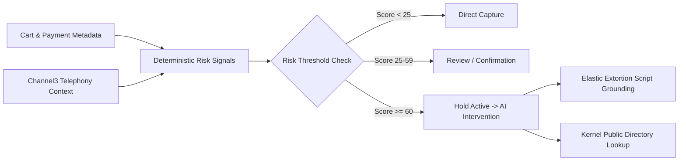

# SCAM BRAKE — AI & RISK INTELLIGENCE SPECIFICATION

---

## 1. Safety Tenets & Ethical Boundaries

1. **Strict Human Agency:** The AI never captures or voids payments on its own. All actions require customer volition or merchant policy parameters.
2. **Empathy First:** Zero shaming, mocking, or sensational alarms.
3. **Zero Secret Eavesdropping:** We never record audio, tap phone lines, or track keystrokes outside checkout.
4. **Data Privacy:** Customer chat transcripts are never fed into public training corpuses.

---

## 2. Multi-Tier Risk Evaluation



---

## 3. Structured Model Output Schema

When evaluating conversation transcripts, the agent outputs structured JSON:

```json
{
  "risk_level": "critical",
  "confidence": 0.96,
  "reason_codes": [
    "AUTHORITY_IMPERSONATION",
    "GIFT_CARD_EXTORTION",
    "SECRECY_COERCION"
  ],
  "observed_signals": [
    "Caller claimed to be IRS Agent Miller with arrest warrant",
    "Customer instructed to purchase Apple store vouchers",
    "Customer instructed not to disclose transaction to cashier"
  ],
  "evidence": [
    "FTC Alert: IRS Never Demands Gift Cards",
    "IC3 Bulletin 2026: Phone Number Spoofing Vectors"
  ],
  "customer_explanation": "Customer believes local sheriff is en route to arrest them.",
  "recommended_questions": [
    "Did the caller instruct you not to hang up?",
    "Would you like us to connect you with the certified IRS switchboard?"
  ],
  "recommended_action": "recommend_void",
  "needs_trusted_contact": true
}
```

