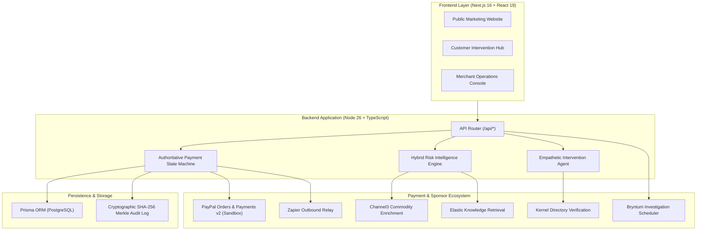

# SCAM BRAKE: SYSTEM ARCHITECTURE SPECIFICATION

> **Status (2026-11-05):** Historical target architecture, not an implementation description. Checkout and customer intervention are disabled; no PayPal Sandbox transaction, AI provider, or sponsor integration has been verified. See [FINAL_AUDIT_BASELINE.md](FINAL_AUDIT_BASELINE.md).

**Tagline:** Stop. Verify. Stay protected.  
**Category:** AI-powered, merchant-integrated pre-capture payment protection protocol.

---

## 1. High-Level Architectural Overview

Scam Brake introduces an empathetic, verified safety pause between PayPal payment authorization and settlement capture to prevent Authorized Push Payment (APP) and voluntary coercion fraud.

---

## 2. Component Subsystems

### 2.1 Authoritative Payment State Machine (`src/server/payments/stateMachine.ts`)
- Manages 14 distinct states (`CREATED`, `BUYER_APPROVED`, `AUTHORIZING`, `AUTHORIZED`, `REVIEW_PENDING`, `AWAITING_CUSTOMER`, `CAPTURE_PENDING`, `CAPTURED`, `VOID_PENDING`, `VOIDED`, etc.).
- Enforces mutual exclusion through in-memory concurrency mutex locks.
- Guarantees idempotency via unique operation keys (`idempotencyKey`).
- Immutable state history chained through SHA-256 Merkle hashes.
- Absolute rule: AI agents and client browsers have zero direct control over financial capture or void endpoints.

### 2.2 Risk Intelligence Engine (`src/server/risk/engine.ts`)
- Evaluates 6 core deterministic telemetry signals:
  1. High-value authorization threshold ($\ge \$1,000$).
  2. Untraceable digital commodities & store vouchers (Apple, Steam, Google Play).
  3. Active remote desktop session (AnyDesk, TeamViewer, QuickAssist).
  4. Concurrent active mobile voice call.
  5. Order attempt velocity spikes.
  6. Customer-reported urgency, secrecy, and criminal arrest threats.
- Formulates AI hypothesis and evaluates merchant risk policies.

### 2.3 Empathetic Intervention Agent (`src/server/ai/agent.ts`)
- Asks exactly ONE calm question at a time.
- Avoids alarmist or humiliating language.
- Prohibits asking for passwords, card numbers, OTPs, or bank PINs.
- Grounds reasoning with Elastic threat vectors.
- Adapts between Astropods API, OpenAI fallback, and deterministic safe reasoning.

### 2.4 PayPal Integration (`src/server/paypal/client.ts`)
- Uses Orders v2 API with `intent = 'AUTHORIZE'`.
- Authorizes hold: `POST /v2/checkout/orders/{id}/authorize`.
- Pre-capture void: `POST /v2/payments/authorizations/{id}/void` ($0 fee, 0 chargeback).
- Settlement capture: `POST /v2/payments/authorizations/{id}/capture`.
- Cryptographic webhook signature verification: `POST /v1/notifications/verify-webhook-signature`.

---

## 3. Deployment Topology
- **Production Server:** Render Web Service (`render.yaml`) hosting Next.js standalone server.
- **Database:** Render Managed PostgreSQL with Prisma migrations.
- **Worker:** Render Background Worker (`src/server/worker/scheduler.ts`) performing durable 30-second sweeps for intervention timeouts and webhook retries.

