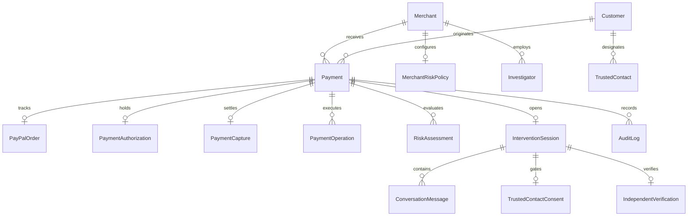

# SCAM BRAKE: DATABASE SPECIFICATION & PRISMA SCHEMA

Scam Brake uses **PostgreSQL** managed through **Prisma ORM**.

---

## 1. Schema Entity Relationship Architecture

---

## 2. Core Tables & Responsibilities

1. **`User` / `Merchant` / `MerchantUser`**: Multi-tenant authorization, API key authentication, and role-based permissions (`ADMIN`, `RISK_ANALYST`, `OPERATOR`, `VIEWER`).
2. **`Customer` / `CustomerSession`**: Tracks verified customer metadata, account age in months, and device telemetry context.
3. **`Payment`**: Primary transactional entity. Stores local state machine state, financial amount in `Decimal(10,2)` (no floating-point rounding), `riskScore`, and timestamps.
4. **`PayPalOrder` / `PaymentAuthorization` / `PaymentCapture`**: 1:1 mapping with PayPal REST API resources (`intent = 'AUTHORIZE'`).
5. **`PaymentOperation`**: Idempotency ledger preventing replay attacks and duplicate financial execution.
6. **`RiskAssessment` / `RiskSignal`**: Historical audit record of deterministic and AI telemetry signals detected during checkout.
7. **`InterventionSession` / `ConversationMessage`**: Stores dialogue transcripts, flagged keywords, and AI confidence scores.
8. **`TrustedContact` / `TrustedContactConsent` / `TrustedContactNotification`**: Strict opt-in consent registry and SMS delivery audit.
9. **`AuditLog`**: Append-only log with deterministic SHA-256 Merkle chain seals.
10. **`Investigator` / `InvestigationCase` / `ScheduledAssignment`**: Bryntum fraud response operations scheduling.

---

## 3. Migrations & Local Development

- Migration script: `prisma/migrations/20261105000000_init/migration.sql`
- Generate Prisma Client: `npm run prisma:generate`
- Seed database: `npm run prisma:seed`
- When `DATABASE_URL` is omitted in local developer setups, `src/server/db/repository.ts` automatically runs in an in-memory/file transactional fallback mode so all tests, APIs, and workflows execute out of the box.

