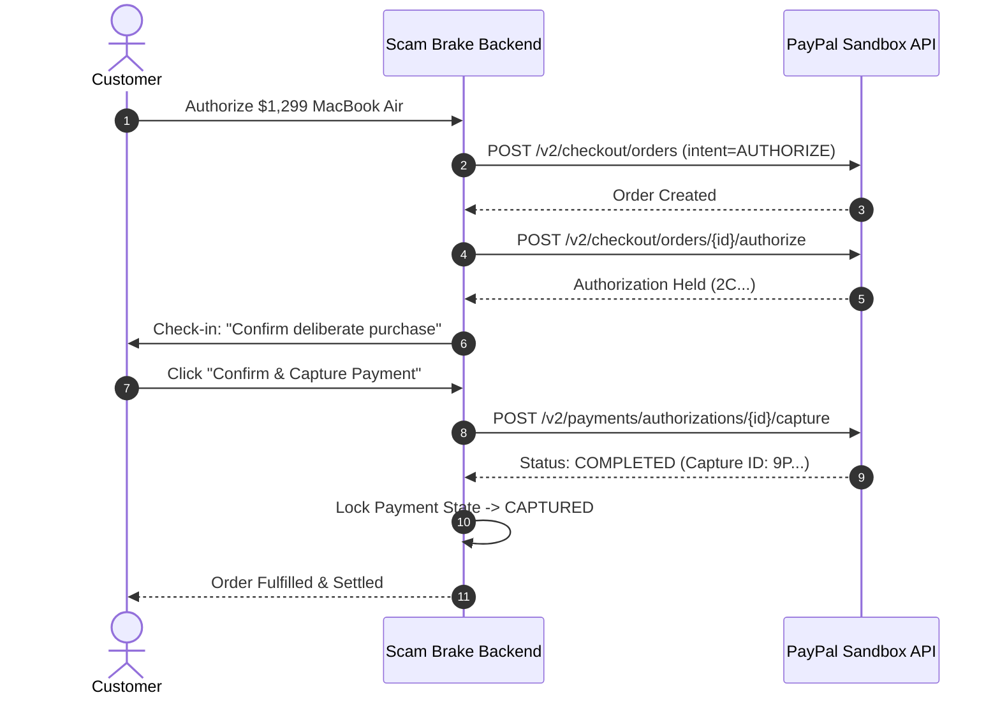

# SCAM BRAKE — PAYMENT LIFECYCLE SPECIFICATION

This document details the exact PayPal two-step authorization hold and settlement lifecycle.

---

## 1. Sequence Diagram: Pre-Capture Authorization Hold to Pre-Capture Void

```mermaid
sequenceDiagram
    autonumber
    actor Customer
    participant Store as Merchant Checkout
    participant Backend as Scam Brake Backend
    participant PayPal as PayPal Sandbox API
    participant AI as Intervention Agent

    Customer->>Store: Click "Pay with PayPal" ($2,000 Gift Cards)
    Store->>Backend: POST /api/checkout/create
    Backend->>Backend: Evaluate Preliminary Risk (Score: 85/100)
    Backend->>PayPal: POST /v2/checkout/orders (intent=AUTHORIZE)
    PayPal-->>Backend: Order Created (ID: 5O...)
    Backend-->>Store: Checkout Session Initialized

    Customer->>PayPal: Approve Order in PayPal Popup
    PayPal-->>Store: Buyer Approval Granted (orderId)
    Store->>Backend: POST /api/checkout/authorize
    Backend->>PayPal: POST /v2/checkout/orders/{id}/authorize
    PayPal-->>Backend: Authorization Held (ID: 2C...)
    Backend->>Backend: Lock Payment State -> HOLD_ACTIVE

    Note over Backend,Customer: Capture is held; Funds paused before leaving account
    Backend-->>Customer: Redirect to /intervention/chat

    Customer->>AI: "The IRS told me I have a warrant and must buy cards"
    AI->>Customer: "The IRS never demands gift cards. Let us verify their official phone."
    Customer->>Backend: Click "Cancel & Void Payment"
    Backend->>Backend: Acquire Concurrency Lock
    Backend->>PayPal: POST /v2/payments/authorizations/{id}/void
    PayPal-->>Backend: Status: VOIDED
    Backend->>Backend: Lock Payment State -> VOIDED
    Backend-->>Customer: Protected Payment Certificate ($0 Fee, $2,000 Saved)
```

---

## 2. Sequence Diagram: Legitimate High-Value Purchase Capture



---

## 3. Financial Mechanics: Pre-Capture Void vs. Chargeback Dispute

| Feature | Post-Capture Chargeback Dispute | Scam Brake Pre-Capture Void |
|---|---|---|
| **Fund Movement** | Money leaves buyer balance to merchant | Money held temporarily in buyer balance; never reaches merchant |
| **Resolution Time** | 14 to 90 days | Immediate (< 1 second) |
| **Merchant Fee** | $15 to $35 non-refundable dispute fee | $0.00 |
| **Merchant Risk Ratio** | Increases chargeback ratio towards merchant ban | 0% impact on chargeback ratio |
| **Consumer Friction** | Complex affidavits, credit freezes | One-click cancellation during intervention |

