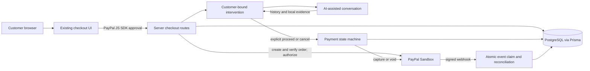

# Release architecture and demo notes

Updated 2026-11-12. This file describes implemented code and known verification limits. It is not evidence of a live payment or provider transaction.

## Current architecture

The AI agent can call OpenAI-compatible chat completions or Astropods when configured. It also has a deterministic local fallback. The fallback and demo payment adapter must be labeled as local simulations; they do not establish live AI or PayPal activity. PostgreSQL is required for persistent checkout and payment flows. See the [release tracker](RELEASE_REMEDIATION_TRACKER.md) for current verification results.

## Suggested video outline

Keep the recording below three minutes and show the application running on the intended device. A practical target is 2:45:

| Time | Show |
|---|---|
| 0:00–0:15 | State the social-engineering problem and who Scam Brake is for. |
| 0:15–0:35 | Show the existing merchant checkout and the selected Sandbox order scenario. |
| 0:35–1:05 | If verified, show the PayPal Sandbox buyer approval and return to the app. Do not show credentials. |
| 1:05–1:20 | Show the server-confirmed authorization state, if the flow succeeded. Explain whether it is Sandbox or simulated. |
| 1:20–1:55 | Show the customer intervention conversation and a real AI-provider response, if configured and confirmed. Explain that AI assists the customer and does not make a definitive fraud decision. |
| 1:55–2:20 | Show the customer explicitly choosing to continue or cancel. |
| 2:20–2:38 | Show the resulting capture/void state only if the provider confirms it. |
| 2:38–2:45 | Close with the product value and clearly identify the demonstrated environment. |

Do not present a deterministic fallback, seeded record, or mocked provider result as a real PayPal or AI transaction. If an end-to-end flow cannot be completed, do not imply that it was verified. The PayPal AI Hackathon requires a functional demo and a public video under three minutes; check the [official rules](https://paypalaihackathon.devpost.com/rules) before submitting.

## Submission materials

- Use the project overview, build tools, and judge setup instructions in [HACKATHON_SUBMISSION.md](HACKATHON_SUBMISSION.md).
- Keep this repository public with the root [MIT license](../LICENSE).
- Provide either a hosted working demo or complete instructions for judges to run the project. Keep required judge access available during the judging period.
- Upload the demonstration video to YouTube with public visibility and add its URL in the submission form.
- Use only screenshots and results from the actual build. Remove personal data, credentials, browser notifications, and unlicensed third-party material.
