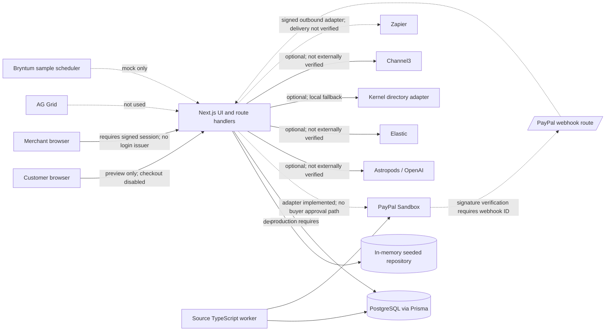

# Release architecture and demo notes

## Current architecture

Dashed provider connections are adapters or configuration only. They are not evidence of a completed payment or live sponsor integration. Production deployment must not be enabled until the release blockers in `FINAL_AUDIT_BASELINE.md` are resolved.

## Three-minute recording script (current honest prototype)

This script demonstrates repository behavior and limitations. It cannot demonstrate a real PayPal payment yet.

| Time | Narration / screen |
|---|---|
| 0:00–0:20 | Explain that a customer may authorize a payment while being pressured by a scammer; current fraud controls may miss the coercion. |
| 0:20–0:45 | Show the Scam Brake prototype and state that this build is not payment ready. |
| 0:45–1:15 | Show the checkout preview. Point out the disabled Sandbox button and explain that no PayPal order, authorization, or hold is created. |
| 1:15–1:55 | Show the local risk engine and deterministic unit test output, clearly labeled as local simulations rather than live AI/payment results. |
| 1:55–2:20 | Show the API protection changes: anonymous session is unauthenticated, payment routes require a signed session, and worker tick requires a separate secret. |
| 2:20–2:45 | Show the audit baseline and security matrix with passed, blocked, and not-run checks. |
| 2:45–3:00 | Explain the next gates: merchant/customer auth, buyer approval, PostgreSQL persistence, sandbox lifecycle, verified webhooks, and tenant tests. |

Do not record a fake void, capture, authorization, customer consent, or externally verified sponsor result. Capture screenshots only from the actual running build and label local simulations on screen.

## Devpost draft (not ready to submit as a completed product)

**Title:** Scam Brake — Stop. Verify. Stay protected.

**Short description:** A prototype exploring a merchant-integrated verification pause between PayPal authorization and capture to address social-engineering pressure.

**Project description:** Scam Brake explores how participating merchants could give customers time and tools to verify a suspicious payment before capture. The current codebase includes a Next.js prototype, a risk scoring module, a payment state-machine adapter, and optional integrations. It does not yet provide a working customer checkout or verified end-to-end payment flow. The checkout UI is disabled while PayPal buyer approval, session authentication, and durable payment persistence are completed.

**PayPal and AI:** PayPal Sandbox REST adapter methods and AI provider adapters are present but were not externally verified. Existing automated demonstrations use deterministic mocks.

**Sponsors:** See `SPONSOR_INTEGRATIONS.md`; no sponsor qualifies as live and verified in this audit.

**Current limitations:** No verified PayPal order/authorization/capture/void IDs; merchant login lacks production provisioning and MFA; the session-revocation migration has not been applied to a configured database; no verified webhook delivery; no customer-bound intervention or trusted contact workflow; no live PostgreSQL integration test; no deployment evidence.

This draft should not be presented as a functioning payment protection product until the release status changes to GO.
