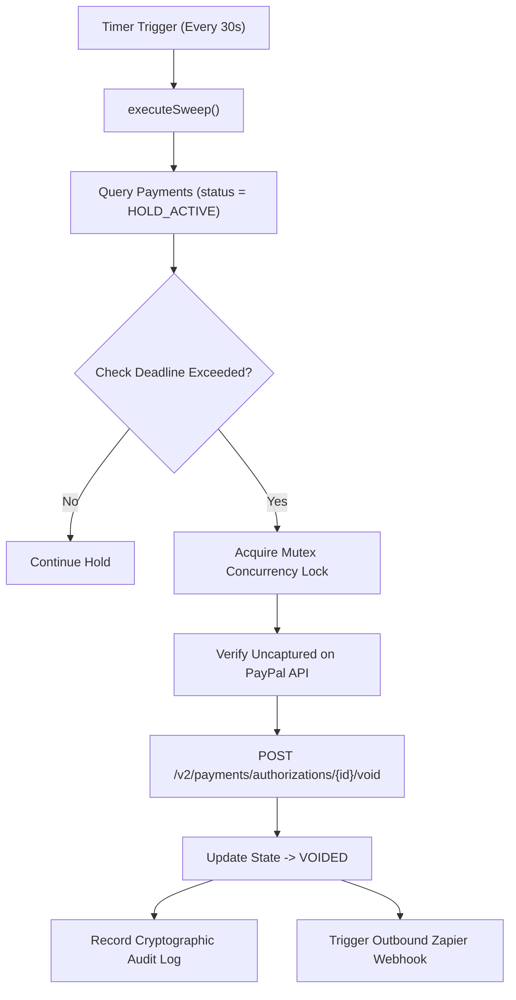

# SCAM BRAKE — RENDER DURABLE BACKGROUND WORKFLOWS

**Sponsor:** Render  
**Classification:** `CONFIGURED_UNVERIFIED` (Infrastructure As Code Configured in `render.yaml`).

---

## 1. Why Durable Background Processing is Mandatory

In an authorization hold protection model, a consumer may:
- Close their laptop or mobile browser.
- Lose internet connectivity.
- Walk away from the intervention screen while under psychological duress.

**Core Rule:** Scam Brake must **never** depend on an open frontend browser window to execute a safety timeout. If an intervention hold lapses without verified customer clearance, the backend must execute an automated pre-capture void to release the consumer's funds.

---

## 2. Worker Architecture (`src/server/worker/scheduler.ts`)

The background worker runs as an independent headless service on Render:

---

## 3. Resilience Guarantees
- **Idempotency:** Worker uses `timeout_void_${payment.id}_${minuteWindow}` as an idempotency key.
- **Concurrency Safety:** Mutex locks prevent concurrent capture attempts while a timeout void is executing.
- **Fail-Safe Default:** If a hold window expires and upstream API fails, the worker continues retrying with exponential backoff until the hold is cleanly resolved.

