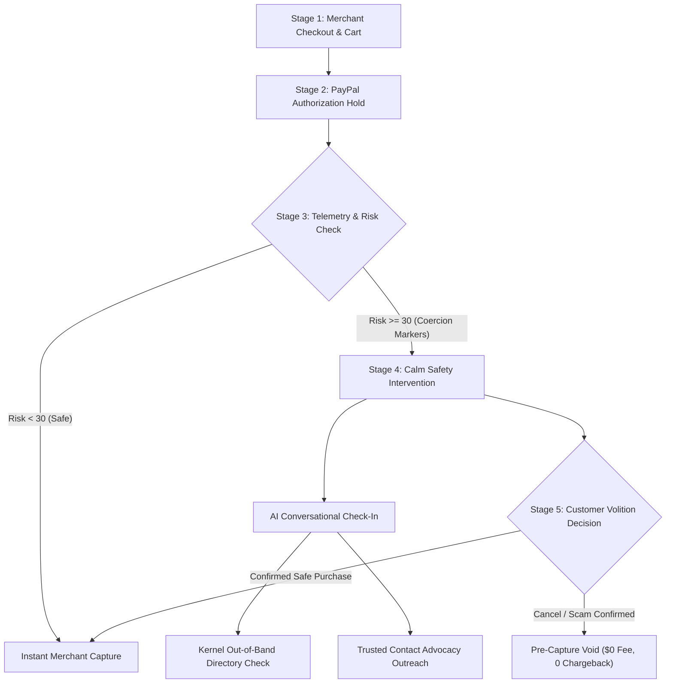
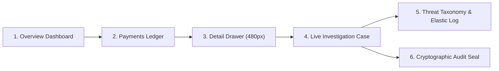

# SCAM BRAKE — USER EXPERIENCE & INTERACTION FLOWS

This document details the complete end-to-end user experience workflows across all customer, merchant, and automated system touchpoints.

---

## 1. Flow Overview & The Five Key Stages

---

## 2. Stage-by-Stage Detailed Specification

### Stage 1: Merchant Protected Checkout (`/checkout`)
- **Customer Action:** The shopper adds products to cart (e.g., Apple Gift Cards or Electronics) on a merchant's e-commerce store.
- **Payment Trigger:** The shopper clicks the PayPal smart button.
- **Underlying Mechanism:** The merchant integration initiates a PayPal order configured with `intent: 'AUTHORIZE'`.
- **UI State:** Standard merchant cart display with clear order summary and Scam Brake protection badge indicating pre-capture verification is active.

### Stage 2: Authorization Creation (`/checkout/authorizing`)
- **System Event:** The customer approves the transaction in the standard PayPal popup modal.
- **PayPal State:** PayPal creates an authorization hold. Available funds in the customer's funding instrument are earmarked, but no capture occurs.
- **Transition Animation:** The customer sees a calm, high-precision transition screen with Scam Brake's Authorization Path visualizing the shift from checkout into the pre-capture review hold.

### Stage 3: Real-Time Risk Assessment (`/checkout/status`)
- **Automated Pipeline:**
  - **Channel3 Telemetry Enrichment:** Evaluates device context, concurrent mobile voice call indicators, and high-velocity digital voucher cart signatures.
  - **Elastic Pattern Clustering:** Matches session attributes against known extortion scripts (IRS back-tax liens, utility cut-off threats, fake bank fraud departments).
- **Branching Decision:**
  - *Low Risk (<30/100):* The server triggers automated capture immediately. The customer sees standard order success.
  - *Elevated / Critical Risk (>=30/100):* Capture is held. The customer is transitioned to the Scam Brake Safety Intervention Hub.

### Stage 4: Customer Safety Intervention (`/intervention`, `/intervention/chat`)
- **Design Philosophy:** Calm, non-punitive, non-alarmist. The interface never shouts "SCAM DETECTED" or makes the victim feel foolish.
- **Reassurance Anchor:** The top banner explicitly reassures the customer:
  > *"Your payment has not been captured yet. PayPal has temporarily authorized this hold so that you can verify this transaction in complete privacy."*
- **Conversational AI Inquiries:**
  - "Did someone on the phone tell you to purchase these items today?"
  - "Were you told not to mention this purchase to anyone?"
  - "Are you settling an urgent government fine or bail bond?"
- **Out-of-Band Verification Tooling:**
  1. **Kernel Directory Lookup (`/intervention/verify`):**
     - Explains Caller ID spoofing.
     - Displays certified public switchboards for IRS (1-800-829-1040), Bank Fraud desks, SSA, and tech support.
  2. **Trusted Contact Outreach (`/intervention/trusted-contact`):**
     - Strict consent gate: No message is sent without explicit checkbox authorization.
     - Sends non-alarming SMS via Zapier/Twilio relay inviting a trusted family member or advocate to consult with the shopper.

### Stage 5: Resolution & Settlement (`/intervention/resolved`, `/intervention/summary`)
- **Decision Pathways:**
  - **Path A: Void Authorization (Scam Averted):**
    - The customer clicks *"Cancel & Void Payment"*.
    - The server issues `POST /v2/payments/authorizations/{id}/void` to PayPal.
    - The hold is released immediately.
    - $0 in merchant processing fees, zero dispute record, and zero negative credit mark.
    - The customer receives an official **Protected Payment Certificate** documenting that their funds were safeguarded.
  - **Path B: Confirm Capture (Legitimate Purchase):**
    - The customer clicks *"Confirm & Capture Payment"*.
    - The server issues `POST /v2/payments/authorizations/{id}/capture` to PayPal.
    - The merchant settles the payment and releases goods.

---

## 3. Merchant Operations Experience Flow (`/merchant/*`)

1. **Morning Operations Review:** The risk manager opens `/merchant` to inspect the 4 core typographic metrics (Total Protected Volume, Active Holds, Confirmed Voided Fraud, Average Resolution Time).
2. **Active Queue Triaging:** Filters by *"Holds Active"* to inspect payments with ticking countdown timers before automated policy expiration.
3. **Deep Investigation:** Clicks into a case to inspect the full transcript, Channel3 confidence scores, and Merkle-sealed audit events.
4. **Manual Governance:** The operator can execute manual voids or captures if out-of-band verification is established directly with the customer.

